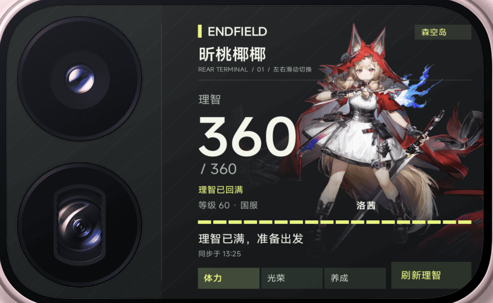
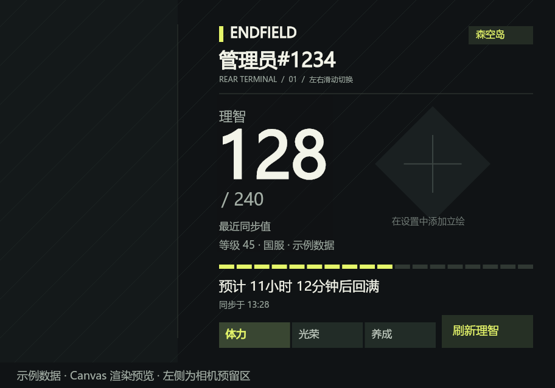
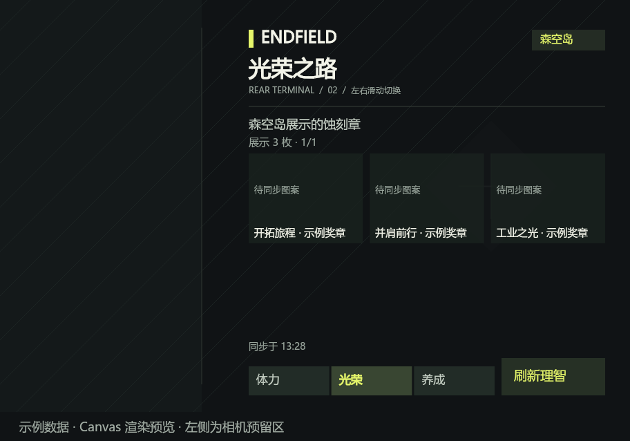
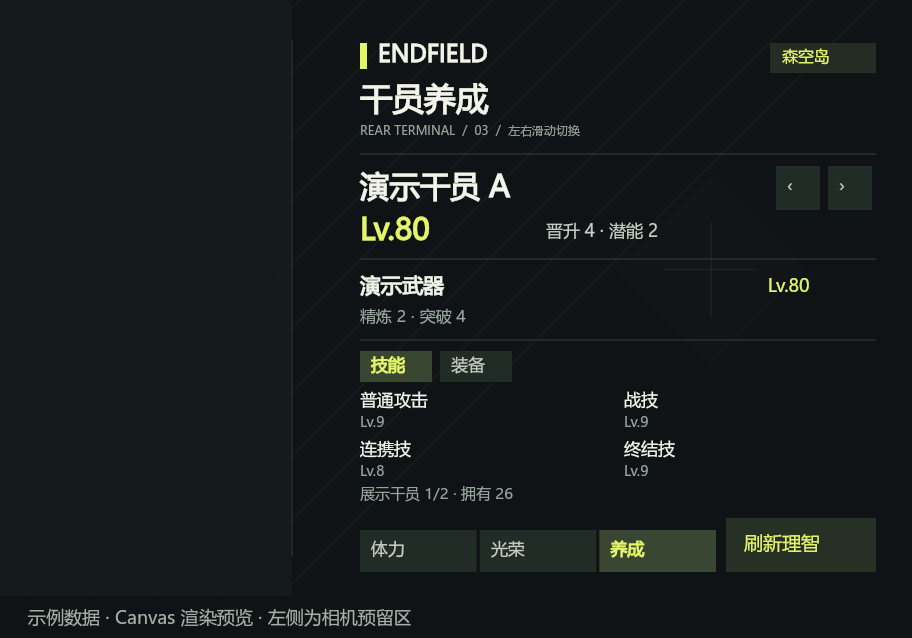
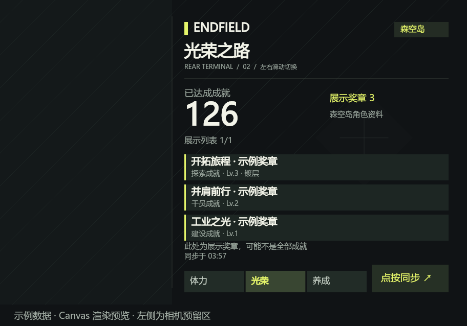
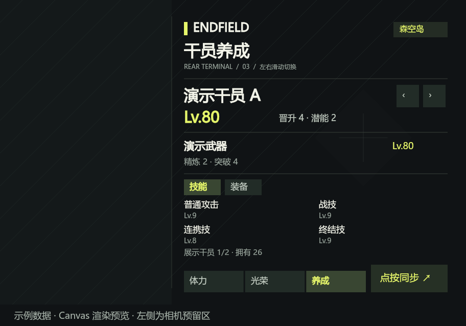

# 终末地 · 体力与立绘背屏模块

[下载 v1.1.6 安装包](https://github.com/misakayuuki/rear-card-endfield/releases/download/v1.1.6/endfield-rear-card-1.1.6.zip) · [发布说明](https://github.com/misakayuuki/rear-card-endfield/releases/tag/v1.1.6)

面向 **rear-card-bridge API 2** 的国服森空岛模块。当前版本：**1.1.6**。背屏与自动刷新只更新理智；展示蚀刻章、干员等级与装备等资料在设置页手动同步。

## 1.1.6 背屏同步修复

1.1.5 已确认正确安装且缓存转换完成，但实机仍失败。实时日志显示认证、详情请求、解压、解析及理智提取均已完成；在读取旧快照、准备保存时出现内存不足，尚未进入缓存写入。

- 理智提取完成后立即清空本次私有响应中的完整资料，避免已完成的异步调用间接保留它；设置页完整同步不受影响。
- 去除图片快照的整份 JSON 克隆，仅复制需要转换的图片容器；释放用完的网络解码缓冲和写入字符串。
- 写后先检查资料时间，未发生新的手动资料同步时不重复展开原有图片。服务已展开的结果可直接交给绘制，减少再次序列化。
- 设置页增加「降低当前立绘占用」：使用当前本地图片，最长边限制为 1280 像素、Data URL 不超过 320,000 字符，保留透明背景；预览后点保存生效。新上传默认仍保留 1600 像素标准。背屏刷新和「同步全部资料」均不会触发此操作。

覆盖安装后重新打开背屏，点击「刷新理智」即可。升级保留已选立绘与登录信息，不需要降低分辨率。内存较紧张的设备可选用设置页「降低当前立绘占用」，预览后保存。

109 项自动测试和完整安装包校验通过。完整宿主运行时模拟中，仿实机数据的 JavaScript 估算内存峰值由 6.64 MB 降至 4.66 MB（约减少 30%）；最大图片回归中最长单次执行约 492 ms。模拟未包括设备原生图片内存。

2026-10-21，测试者保留原高清立绘实机复测，确认「同步于」时间正常更新、切页正常；日志记录从请求到保存完成的完整成功流程，实机脚本哈希与发布包一致。

本版实机截图（商店封面）：



以下为本版绘制代码生成的示例数据预览，左侧为空出的相机遮挡区域；角色立绘需在设置页自行选择。





## 1.1.5 背屏传输体积修复测试

以下 1.1.2–1.1.5 段落为历史排查记录，其中的待验证状态不代表当前已通过实机复测的 1.1.6。

按新的使用方式，背屏「刷新理智」及自动刷新只更新理智与恢复时间。昵称、玩家等级、展示蚀刻章、干员等级和装备沿用上次资料；到设置页点击「同步全部资料」才更新这些内容。资料同步时间与理智刷新时间分别保存。立绘只在设置页手动选择保存时更换。

目前可核实的森空岛接口仍返回完整账号详情，模块只处理其中的理智字段；不猜测未证实的轻量接口。因此保留以下传输和分帧处理修复，不能只靠减少界面更新字段解决接收超时。

1.1.4 实机仍然同步超时或失败。后续日志出现 QuickJS 内存不足；读取实机当前完整显示数据，发现其约 51 万字符实际占用 **1,104,650 UTF-8 字节**。旧图片紧凑编码减少了字符数，却增加了 UTF-8 字节数，之前仅检查字符数量不足以保障背屏传输。

- 改用兼顾 UTF-8 和 UTF-16 的无损图片编码，兼容旧缓存；不重新下载或降低立绘清晰度。
- 缩小随卡片传输的脚本，校验完整脚本、最大图片、中文资料及 Android JSON 转义后的传输体积。
- 加入同步步骤诊断，仅记录固定步骤名和数字大小，方便定位请求、解析或保存阶段；不记录账号、凭据和响应内容。

**覆盖安装后先在模块设置页刷新一次**，将已保存的旧快照转换为新编码，再重新打开背屏卡片测试同步。升级保留已选立绘。此版本仍待实机确认，不替换公开发布的 1.1.1。

1.1.5 已通过 103 项自动测试及完整安装包校验。使用实际编译脚本和宿主运行时的 QuickJS 回归确认仅理智改变，昵称、徽章、养成资料、立绘和资料时间均不变；未产生图片下载请求，最终回归最长单次执行约 737ms，未触发 1500ms 限制。手机当前数据按新版编码的完整传输从约 110 万降为约 75 万字节。这些检查不替代实机同步复测。

## 1.1.4 动态数据同步修复测试

- 背屏同步仅更新理智、展示徽章、干员等级与装备等动态资料。沿用当前立绘，不重新下载立绘、不读取独立立绘存储、不更新设置页的立绘候选列表。
- 读取背屏已有快照、合并小配置查询，减少图片分块的重复往返；旧缓存片段清理合并为小请求批次。高清大块写入仍逐段完成。
- 含最大图片缓存与两个并发页面重载的慢桥测试，从 68 个逐秒批次减至 25 个。为覆盖网络连接等待与分帧解码，整个同步上限设为 60 秒，仍不自动重试。
- 首帧图片校验改为常量辅助空间的扫描，避免低内存 QuickJS 在超长图片正则校验时耗尽内存。

宿主共享快照接口要求提交完整画面状态，所以保存理智时仍会带上原有图片供息屏显示；这不会重新获取、缩放或更换立绘。立绘只在设置页手动选择时更换。正式发布仍等待实机复测。

1.1.4 已通过 84 项自动测试、安装包校验及实际编译脚本的 QuickJS 分帧回归；合成 6.49MB 中文与 7.72MB ASCII 详情均成功完成，未触发每帧1500ms中断。桌面测试不等同于手机实测。

## 1.1.3 同步卡死修复测试

实机日志确认 1.1.2 在 UTF-8 转换时触发背屏 QuickJS 的 **1500 毫秒单次执行限制**，中断当前帧后，绘制和触摸一起停止。普通网络超时无法恢复被中断的引擎帧循环。

详情处理改为分块解码、流式解压和流式 UTF-8 转换，并通过背屏 RAF 真正让出执行；保留完整响应解析和原有体力、展示蚀刻章、干员资料。设置网页和后台刷新方式保持原样。下面 1.1.2 的镜头分割线与缓存改动继续保留。

安装测试包后重新打开卡片，点按同步时可尝试切页；需确认同步时间更新、同步后切页仍正常，再发布该修复。

## 1.1.2 修复测试

- 按实机镜头位置将分割线向左调整，保留文字与按钮原有安全区。
- 背屏详情请求协商 gzip 压缩，避免原始账号详情过大导致桥接丢失响应；设置页和后台仍使用原来的请求方式。
- 同一背屏内的缓存读取排队，避免多个图片片段挤进同一回包；高清快照采用无损紧凑编码传输，首帧同步还原图片，不降低立绘清晰度。
- 同步设置总等待上限，超时后保留旧数据并恢复按钮；迟到的请求不会覆盖后续成功的数据。

覆盖安装后，在模块设置页刷新一次，再测试背屏点按同步及息屏后显示。该修复仍需实机确认，暂未替换公开版本。

1.1.2 通过 73 项自动测试及安装包编译校验，但后续实机测试发现上述执行超时；仅通过普通 JavaScript 测试不足以证明背屏运行正常。

## 实机展示

以下为测试者提供的实机截图：体力与立绘为 1.1.6，展示蚀刻章和干员养成为 1.1.1 的历史效果参考。模块安装包不包含截图中的账号数据和角色图片。

<p>
  
  
  
</p>

## 使用

1. 在卡片桥选择「安装 ZIP 模块」，导入交付包，不要解压。
2. 按卡片桥提示选择本地卡片载体，写入并绑定；第一次使用要到系统背屏设置移除旧卡、重新应用。
3. 打开本模块的设置页，连接森空岛并选择终末地账号角色。
4. 同步后，可从森空岛展示的干员中选择立绘，也可以上传 PNG、JPEG、WebP 图片。调整大小、位置、显示方式和角色名称，再保存。由旧版升级时需重新选择原图，或再次点「使用立绘」，才能获得更清晰的版本。
5. 在卡片桥「设置与关于」开启后台刷新，并在模块详情设置周期。默认 15 分钟，桥实际最短 5 分钟。

需要使用开发指南所述的新运行时；旧运行时缺少全局 Promise 与共享快照链路时，应先更新卡片桥及载体资源，再重新应用系统卡片。

## 连接国服账号

模块设置页会显示网址文本。请在**电脑上的同一个浏览器**中依次打开以下网址：

1. 在电脑浏览器地址栏输入 `https://www.skland.com/`，登录已绑定终末地的账号。
2. 保持登录，在电脑的同一个浏览器地址栏输入 `https://web-api.skland.com/account/info/hg`。
3. 复制返回 JSON 中的 `data.content` 值，或复制整个 JSON，回到手机模块设置页，在 Token 输入框粘贴并连接。
4. 选择已绑定的终末地角色。如果没有角色，先在森空岛完成游戏绑定。

登录信息相当于账号凭据，仅在手机模块设置页输入，不要发到聊天、群聊或截图中。模块直接访问鹰角/森空岛接口，无中转服务；凭据保存在卡片桥的模块业务存储，既不写进背屏快照，也不输出日志。模块存储由宿主应用管理，本模块不额外声称提供加密保险库。断开连接会清除本模块保存的凭据和账号数据，保留外观与已选立绘。

若电脑浏览器展示 401、未登录或没有 `data.content`，请确认已在这同一个浏览器中登录森空岛，再重新打开第二个网址。

## 左右滑动查看数据

- 体力、光荣之路、干员养成共三页，可左右滑动或点按底部页签切换。
- 体力页顶部展示玩家的完整「昵称#短ID」。短 ID 来自游戏昵称文本；接口没有提供时仅显示昵称，不使用账号 UID 冒充。
- 光荣之路展示你在森空岛选中的蚀刻章图案，保留展示顺序，并匹配镀层、重铸状态。每页最多六枚，可翻页；未设置展示时会提示，不用全部已获成就替代。
- 安装升级后在模块设置页点「同步全部资料」，下载并缓存展示蚀刻章。之后更改森空岛展示章时，再到设置页手动同步。图片未获取时保留该展示位并提示待同步；缺失展示配置时不会猜测。
- 干员养成可切换查看接口返回的干员等级、晋升、潜能、武器、技能和装备资料。森空岛可能只返回个人资料中展示的干员，页面中的展示名单不代表完整仓库；拥有总数单独使用接口字段。
- 背屏与自动刷新只更新理智；光荣之路和干员养成保留设置页上次手动同步的资料。离线或失败时保留上次快照。为控制背屏首帧体积，奖章与干员详情按预算保留，发生截断会显示提示。

## 体力与立绘

- 体力数字是森空岛**最近同步的值**；0 会正常显示，不会被当成未获取。
- 回满倒计时取自接口返回的 `maxTs`。接口未提供每点恢复间隔，默认不擅自增加体力数字；回满时显示「预计已回满 · 待同步」，下一次成功同步后更新数字。
- 超过 30 分钟的理智数据标记为缓存；同步失败保留上次数据。卡片右下角可点「刷新理智」。
- 点亮时刷新间隔由模块设置页控制，后台周期由卡片桥模块详情控制。手机休眠、省电和系统调度可能延迟后台刷新；后台保存快照不等于主动唤醒背屏。
- 默认以 912 × 596 布局，左侧预留 336 单位给相机，内容从 360 开始；装饰分割线位于 292，更靠近实际镜头右缘。可在设置页调整遮挡区域；实际尺寸与触摸位置以手机为准。
- 立绘占据更大的背景区域，默认放大至 120%；设置页可在 100%–250% 之间调整大小，并配合横向、纵向位置对准人物。
- 一次保存一张立绘，最长边上限从 640 提升至 1600 像素，优先 WebP 高质量编码并保留透明背景，不放大低分辨率原图。先调整编码质量，超出体积预算时才缩小尺寸；立绘 Data URL 上限为 480,000 字符。
- 若实机图片内存紧张，可在设置页手动点击「降低当前立绘占用」，按最长边 1280 像素和 320,000 字符重新处理当前本地图片，预览后保存。
- 大图片分段保存并排队读取，避免背屏桥单次返回过大；共享快照对图片做可逆紧凑编码，背屏首帧同步恢复完整 Data URL。蚀刻章图案最多占 240,000 字符，展开的快照不超过 760,000 字符。
- 图片缩放由设置页的 WebView 完成。背屏和后台刷新沿用已有章图；更换展示章后，请在设置页点「同步全部资料」。
- 角色列表来自本人账号的森空岛资料。接口未提供立绘或下载失败时仍可使用本地上传；模块包没有预装角色图片。

## 本地开发

要求 Node.js 22.18+ 或 24.11+。源码在 `src/`，共享逻辑在 `src/shared/`，构建时复制到背屏与设置页，并合并为独立后台入口。

```powershell
git clone https://github.com/finall1008/rear-card-bridge.git upstream/rear-card-bridge
git -C upstream/rear-card-bridge checkout 1e1fcc77a4b8d3c5398e60c715d397bb12b295ba
npm ci
npm ci --prefix upstream/rear-card-bridge/tools/card-build
npm test
npm run build
npm run preview
```

- 设置页预览：[http://127.0.0.1:4173/](http://127.0.0.1:4173/)。无原生 bridge 时只演示示例数据，不接收真实账号。
- 真实绘制代码预览：[http://127.0.0.1:4173/card-preview.html](http://127.0.0.1:4173/card-preview.html)。可切换零体力、已满、异常、未连接并试放图片。
- 安装包：`dist/endfield-rear-card-1.1.6.zip`。ZIP 根目录直接包含 `module.json`。
- `card/` 脚本由上游官方构建工具编译 async/await 为生成器，再去掉空白与注释；fflate 使用固定版本 esbuild 仅打包两个流式解码组件。`webroot/` 和 `background/` 保持原生 async/await。
- `bridge-shim.js` 由卡片桥注入，源码和 ZIP 不自行携带替代实现。

## 验证范围

本地测试覆盖签名与账号身份区分、认证流程、失败不重试、体力边界、多页数据、快照、图片体积限制、退出登录后的在途请求、RAF 绘制、滑动切页、触摸取消和热更新清理。预览用于布局和交互检查。

1.1.1 已通过 54 项自动测试及安装包校验。2026-10-21，测试者完成实机测试并确认可以发布，提供了体力与立绘、展示蚀刻章、干员养成三页截图。实际效果和后台刷新频率仍受设备、系统版本与卡片桥配置影响。

## 参考与第三方组件

- [模块开发指南](https://github.com/finall1008/rear-card-bridge/blob/main/docs/module-development.md)
- [小米背屏应用卡开发指南](https://github.com/finall1008/rear-card-bridge/blob/main/docs/app-card-development.md)
- API 字段及客户端实现来源详见 `research/api-notes.md`。这是社区模块，非鹰角官方产品；接口变化可能需要更新。
- 请求签名使用 CryptoJS 4.2.0 的 HMAC-SHA256 与 MD5，实现不依赖 WebCrypto。MIT 授权文本随安装包放在 `webroot/crypto-js-LICENSE.txt`。
- 背屏压缩响应使用 fflate 0.8.3 流式解码，分批让出背屏执行时间，MIT 授权文本随安装包放在 `card/fflate-LICENSE.txt`。
- 干员立绘归其权利人所有，按用户选择从接口获取或由用户本地上传。
